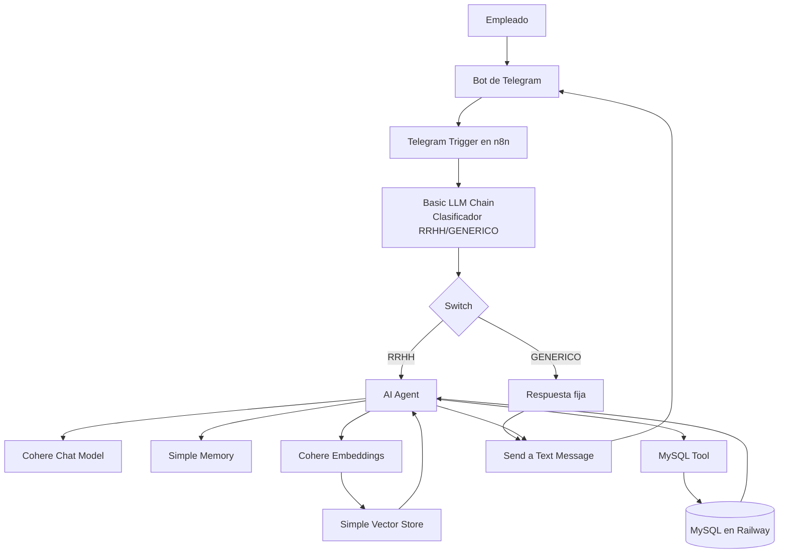

# HR Buddy 🍫 - Asistente Virtual de RR.HH. para Chocola Tech

**HR Buddy** es un agente de Inteligencia Artificial y asistente virtual de Recursos Humanos desarrollado como proyecto práctico para el **Curso de Inmersión en Agentes IA**. El sistema fue diseñado para resolver consultas operativas y consultar datos personales de los empleados de la empresa ficticia *Chocola Tech*, utilizando un enfoque híbrido de bajo código y desarrollo de agentes avanzados.

---

## 🚀 Características Principales

*   🤖 **Agente de IA Cognitivo:** Orquestado en **n8n** utilizando el modelo **Cohere Chat Model** con memoria de conversación integrada (`Simple Memory`).
*   📚 **Arquitectura RAG (Retrieval-Augmented Generation):** Búsqueda semántica sobre políticas internas de la empresa utilizando `Cohere Embeddings` y `Simple Vector Store`.
*   🗄️ **Integración de Datos Relacionales:** Conexión en tiempo real con una base de datos **MySQL** alojada en **Railway** para consultar saldos de vacaciones, banco de horas y datos contractuales.
*   📱 **Interfaz Omnicanal:** Desplegado directamente como un Bot de **Telegram**.

---

## 📐 Arquitectura del Sistema

El flujo de trabajo implementa un patrón robusto que optimiza tanto el coste de los tokens como la seguridad del acceso a los datos:

### 🔄 Flujo de procesamiento

1. El empleado envía su consulta desde **Telegram**.
2. **n8n** recibe el mensaje con `Telegram Trigger`.
3. Un **Basic LLM Chain** clasifica la entrada como `RRHH` o `GENERICO`.
4. El nodo **Switch** enruta el flujo:
   - `GENERICO`: responde con un texto fijo sin invocar al agente completo.
   - `RRHH`: envía la consulta al **AI Agent**.
5. El **AI Agent** usa el **Cohere Chat Model** como motor principal de razonamiento y generación.
6. **Simple Memory** mantiene el contexto conversacional para respuestas coherentes entre turnos.
7. Si la consulta es documental, el agente aplica **RAG** con **Cohere Embeddings** + **Simple Vector Store** para recuperar políticas internas.
8. Si la consulta requiere datos personales u operativos, el agente usa **MySQL Tool** para consultar **MySQL** alojado en **Railway**.
9. Con la evidencia recuperada (documental o transaccional), el agente genera la respuesta y n8n la devuelve a Telegram.

### 🧩 Componentes y responsabilidades

| Componente | Responsabilidad principal |
| --- | --- |
| **Telegram Bot** | Canal de interacción con los empleados. |
| **n8n** | Orquesta el flujo, clasifica mensajes y coordina el agente. |
| **AI Agent + Cohere Chat Model** | Interpreta consultas y construye la respuesta final. |
| **Simple Memory** | Conserva contexto de conversación entre mensajes. |
| **Cohere Embeddings** | Vectoriza consultas/documentos para búsqueda semántica. |
| **Simple Vector Store** | Almacena y recupera conocimiento documental de RR.HH. |
| **MySQL Tool + MySQL (Railway)** | Consulta datos operativos y personales estructurados. |

### 📚 RAG documental vs. consultas operativas

- **Consultas documentales (RAG):** se responden con políticas y lineamientos internos desde **Simple Vector Store**, recuperados semánticamente con **Cohere Embeddings**.
- **Consultas de datos operativos (MySQL):** se responden con información estructurada en **MySQL en Railway** (por ejemplo, vacaciones, banco de horas y datos contractuales).

Esta separación evita mezclar conocimiento estático con datos transaccionales sensibles y mejora precisión, seguridad y trazabilidad de las respuestas.
